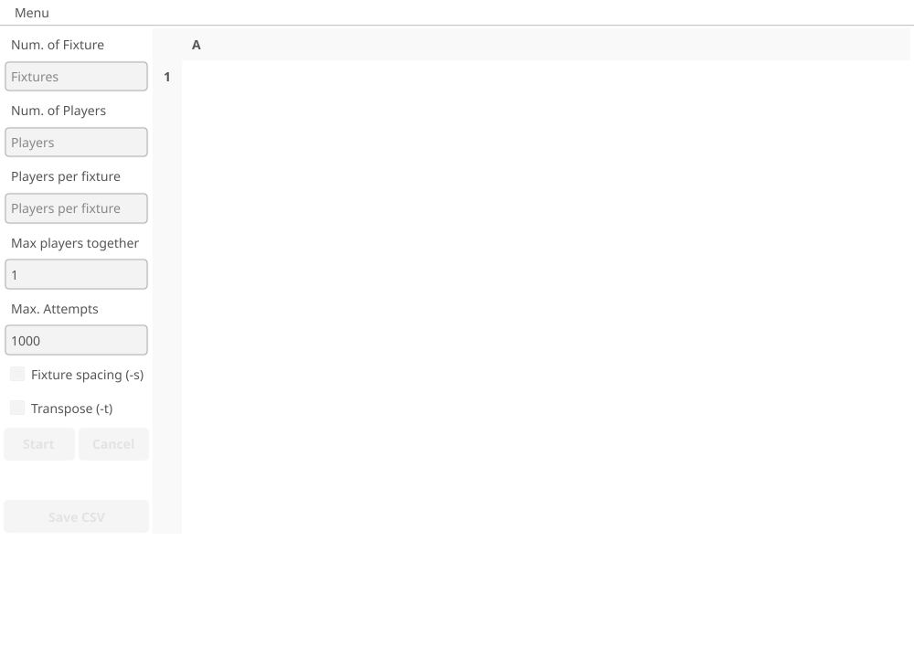
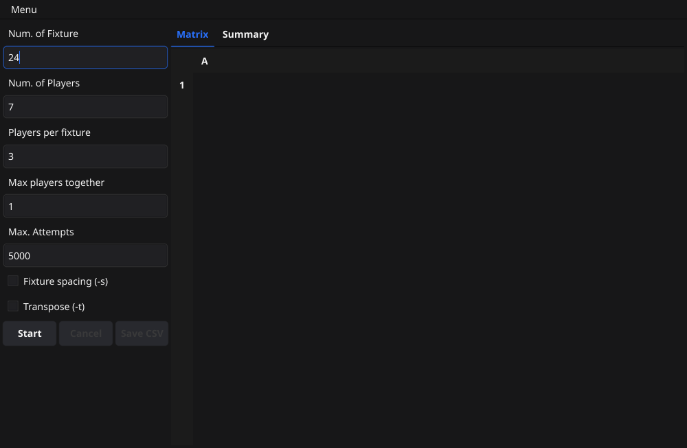
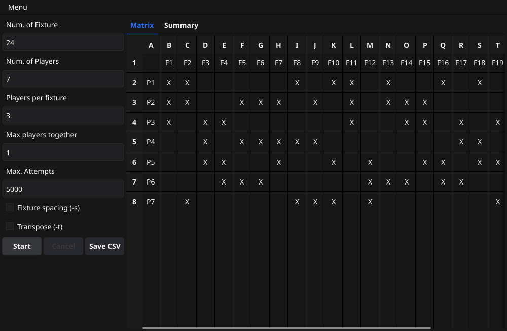
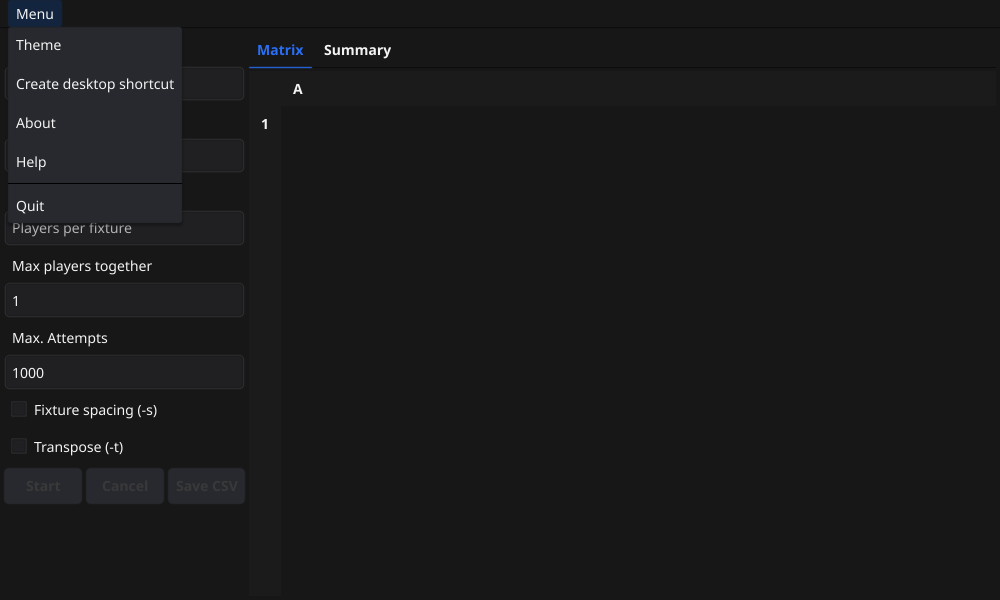

# Desktop app guide

Audience: people who want to create a distribution without using a terminal. This guide describes the desktop app as
released in the current version. For the command-line tool, see the [README](../README.md).

The desktop app does the same job as the CLI, in a window. It is `gamedistapp` on Linux and `gamedistapp.exe` on Windows.
Both are in the release archive with the CLI.

*Linux, dark theme. The Windows appearance has not been checked on a real Windows machine.*

## Starting the app

Run `gamedistapp` on Linux, or double-click `gamedistapp.exe` on Windows.

A splash screen shows for about five seconds. The controls are disabled until it finishes.

## Setting up a distribution

The inputs are on the left, with the labels used in the app:

- **Num. of Fixture:** the number of fixtures, from 1 to 200.
- **Num. of Players:** the number of players, from 1 to 100.
- **Players per fixture:** how many players take part in each fixture. It must be at least 1 and no more than the number of
  players.
- **Max players together:** the most fixtures any two players may share. The default is 1. If that is impossible for the
  other settings, it is raised automatically, and the summary says so.
- **Max. Attempts:** how many random attempts the program makes before giving up, from 1000 to 100000. The default is 1000.
  A run can fail at 1000 attempts even when a solution exists, so raise this if you see "too many attempts". For 24
  fixtures, 7 players and 3 per fixture, 5000 attempts is reliable.
- **Fixture spacing (-s):** tries to stop players from playing in back-to-back fixtures. It is off by default, and it is a
  preference rather than a guarantee.
- **Transpose (-t):** swaps rows and columns, so fixtures are the rows and players are the columns.

An invalid value shows a message in red under its input, and **Start** stays disabled until every input is valid. The
options start at the CLI defaults.

*Linux, dark theme.*

## Running a distribution

Press **Start**. The run happens in the background. A spinner shows that it is working, and the status line shows the attempt
number, for example "Attempt 12 of 1000".

Press **Cancel** to stop a run. A cancelled run shows no matrix, and the Summary tab says "Cancelled after N attempts".
The inputs cannot be changed while a run is going.

## Reading the results

- The **Matrix** tab shows the matrix. An `X` marks a player taking part in a fixture, and a blank cell means they are not.
  Rows and columns are labelled `P1` to `Pn` for players and `F1` to `Fn` for fixtures. Players are the rows by default.
  Scroll in either direction for large matrices.
- The **Summary** tab shows the summary, in the same wording as the CLI: the players and fixtures, how many fixtures each
  player must play, how many players play an extra fixture, whether fixture spacing applied, the maximum play-together value
  in use, and the attempt number. Errors and notes also appear here.

If a run fails, the **Summary** tab opens by itself and shows the error. For example, "too many attempts, exiting. Tried
1000 of 1000" means the attempts limit was reached before a valid distribution was found. A cancelled run also opens the
Summary tab. A successful run opens the **Matrix** tab.

Changing **Transpose** redraws the matrix straight away. Changing any other input clears the matrix and disables **Save
CSV**, so you always save the result that matches the inputs.

*Linux, dark theme. The matrix has players as rows and fixtures as columns, and the summary is on the Summary tab.*

## Saving the result

**Save CSV** is enabled once a matrix has been generated. It opens a save dialog with the default name `distribution.csv`.
The file is described in [Saving the distribution as CSV](../README.md#saving-the-distribution-as-csv).

## Menu

The **Menu** in the window has these entries:

- **Theme:** opens a dialog with **Light**, **Dark** and **System**. **OK** applies the theme and remembers it for next time.
  **Cancel** changes nothing. The app starts in the light theme until you choose another.
- **Create desktop shortcut:** Linux only. Puts a shortcut on your Desktop, and asks whether to add a menu entry. See [Desktop shortcut](#desktop-shortcut).
- **About:** shows the version and the licence, with a link to the release page for that version.
- **Help:** opens the desktop app guide for the version you are running, in your default web browser. If the browser cannot be opened,
  an error dialog says so.
- **Quit:** closes the app.

The menu entries have no keyboard shortcuts.

*Linux, dark theme. The Create desktop shortcut entry is shown on Linux only.*

## Desktop shortcut

On Linux, the packages add Game Distributor to the application menu, under Utilities. The app can also put a shortcut on
your Desktop.

When the app starts, after the splash, it asks whether to create a desktop shortcut. The dialog has three choices:

- **Create** makes the shortcut on your Desktop, and remembers the choice, so the question does not come back.
- **Not now** does nothing. The question comes back the next time you start the app.
- **Never ask** stops the question. You can still create the shortcut from the menu.

Closing the dialog without choosing a button is the same as **Not now**.

The question is not asked when you run the app as root, when there is no Desktop folder, or on Windows.

**Menu > Create desktop shortcut** works at any time. If the shortcut and the menu entry are already up to date, it says so.
Otherwise it asks you to confirm. Tick **Also add to the application menu** to add a menu entry as well. The `.deb` and `.rpm`
packages already have one, so the option is shown only when the app is not installed from a package.

- The app writes the shortcut itself, using the full path of the program it was started from. If you move the program, or
  install a `.deb` or `.rpm` over a `.tar.gz` copy, the shortcut is updated the next time the app starts.
- The app changes only the files it made. If a file with the same name is already on your Desktop, and the app did not make
  it, the app leaves it alone and says so.
- The app does not create a shortcut when it is run from a temporary folder. Install the app first, or run it from its folder.
- If the app cannot create the shortcut, for example because the Desktop folder is read-only, it tells you why and carries on.
- On GNOME, the shortcut is marked as trusted, so that a double-click opens it. If GNOME still refuses to open it, right-click
  the shortcut, choose **Properties**, open the **Permissions** tab, and tick **Allow executing file as program**.
- On GNOME, if Desktop icons are hidden, for example because the Desktop Icons extension is not enabled, the shortcut is
  created but may not show on the desktop. Open your Desktop folder in Files to find it.

**Removing the package:** `sudo apt remove gamedist` and `sudo dnf remove gamedist` remove the programs, but not your Desktop
shortcut. The shortcut then stops working, so delete it by hand if you no longer want it.

## Hover help

Rest the pointer on an input or its label for about one second, and a short explanation appears beside it. The explanation
disappears when the pointer leaves, or when you click the input.
